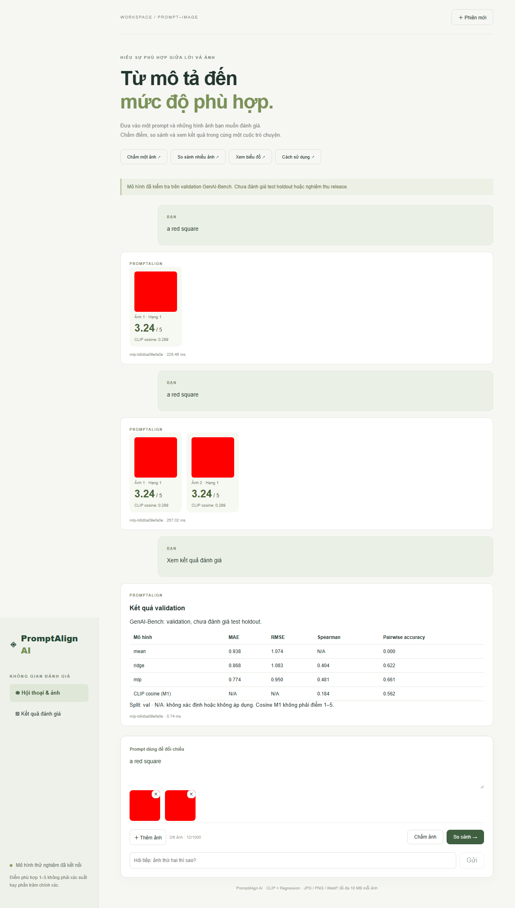

# Tổng hợp kết quả dự án PromptAlign AI

**Ngày chốt nội dung: 27/10/2026. Phạm vi: kết quả validation và tích hợp local; chưa nghiệm thu release.**

## 1. Tóm tắt dùng cho bản báo cáo

Dự án xây dựng ứng dụng hội thoại đánh giá độ phù hợp giữa mô tả và ảnh, gồm chấm điểm 1–5, so sánh 2–6 ảnh cùng prompt và hiển thị dashboard thực nghiệm. Nhóm sử dụng CLIP pretrained được giữ cố định để trích đặc trưng văn bản/ảnh, sau đó huấn luyện Ridge và MLP dự đoán điểm đánh giá trung bình của con người. Dữ liệu GenAI-Bench gồm 1.600 prompt từ 12 shard; sau QA giữ 9.598 cặp hợp lệ và chia theo nhóm prompt thành 6.718/1.440/1.440 cặp train/validation/test. Trên validation, MLP seed 42 đạt MAE 0,773777, RMSE 0,950154, Spearman 0,480619 và pairwise accuracy 66,1340%. Mô hình đã được kiểm chứng tải lại trên CPU và tích hợp vào FastAPI–React. Kết quả này chưa chứng minh chất lượng trên test holdout hoặc tập ảnh mới; nghiệm thu người dùng và một số hạng mục release vẫn còn chờ.

## 2. Dữ liệu và quyết định QA

Nguồn dữ liệu: `BaiqiL/GenAI-Bench`, revision `94e543b0801feade1419873335191de90b68d164`. Nhãn là trung bình ba rating nguyên trong [1,5]. Sáu nguồn ảnh: DALLE_3, DeepFloyd_I_XL_v1, Midjourney_6, SDXL_2_1, SDXL_Base, SDXL_Turbo.

| Tập | Số nhóm prompt | Cặp ảnh–prompt |
|---|---:|---:|
| Train | 1.120 | 6.718 |
| Validation | 240 | 1.440 |
| Test, chưa đánh giá | 240 | 1.440 |
| Tổng | 1.600 | 9.598 |

Hai cặp bị loại vì không thỏa điều kiện rating: shard 1, row 97/DALLE_3 và row 118/DeepFloyd_I_XL_v1 (chỉ số từ 0). Không tự sửa nhãn khi thiếu giá trị gốc. Hai cặp prompt gần trùng cùng ở train được giữ: head/paw khác nghĩa; cặp chỉ khác dấu phẩy được giữ với giới hạn tăng trọng số nội dung. Kiểm manifest không phát hiện prompt chuẩn hóa hoặc ảnh cùng checksum xuyên split. Heuristic từ vựng không chứng minh đã loại hết trùng ngữ nghĩa; review local không đọc lại toàn bộ raw Parquet.

Manifest SHA256: `4ed1e3c7909c81c239beaa2890f4adbcaef7545217e1d309a8b023e084182ca2`. Quyết định dữ liệu được người dùng xác nhận, lock ghi reviewer `hoan`. Trạng thái REVIEW_REQUIRED trong QA gốc là lịch sử trước xác nhận, không phải lỗi training. Chi tiết: [quyết định dữ liệu](evidence/DATA_DECISIONS.md), [QA](evidence/G1_kaggle_full_qa_review.json).

## 3. Phương pháp và cấu hình

- CLIP `openai/clip-vit-base-patch32`, revision `3d74acf9a28c67741b2f4f2ea7635f0aaf6f0268`; mỗi embedding 512 chiều, chuẩn hóa; encoder frozen. Nối text/image thành vector 1.024 chiều, không đưa rating hoặc nhãn generator vào đặc trưng.
- M0 dự đoán trung bình train (khoảng 3,388508). M1 dùng cosine thô, không ánh xạ sang thang điểm con người.
- Scaler chỉ fit train. Ridge dùng L2 alpha=1, intercept không penalty và clamp đầu ra [1,5].
- MLP: Linear(1024,64) → ReLU → Linear(64,1) → `1 + 4*sigmoid`; Adam full-batch CPU, learning rate 0,001, loss MSE, tối đa 100 epoch, patience 15; chọn best epoch theo validation MAE.
- Seed 42 là run chính định trước; 43/44 kiểm độ ổn định trên cùng split. Seed 42 tốt nhất epoch 20, dừng epoch 35. Chọn MLP trong các head theo validation MAE; không chọn lại seed vì kết quả đẹp hơn.
- Extraction trên Kaggle Tesla T4, 9.598×512 cho mỗi loại embedding, 256,17 giây theo biên bản; fingerprint CLIP không đổi. Source training `2b48cca92bc7212e34f6ba44b05ac51ffbda97e1`, Python 3.13.15, torch 2.8.0+cu126.

Xếp hạng trong ứng dụng là sắp xếp điểm hồi quy. Chưa có M3/pairwise loss, fine-tuning CLIP, caption hoặc VLM. Chat controller theo quy tắc, không phải LLM. Cấu hình và lịch sử gốc: [training seed 42](evidence/training_seed42.json).

## 4. Kết quả thực nghiệm

Các bảng dưới dùng **CPU replay trên validation**, nguồn [G3_full_training_review.json](evidence/G3_full_training_review.json). MAE/RMSE càng thấp càng tốt; Spearman và pairwise accuracy càng cao càng tốt.

| Model | MAE | RMSE | Spearman | Pairwise_accuracy |
| --- | --- | --- | --- | --- |
| M0 mean | 0.937855 | 1.073653 | N/A | 0.000000 |
| M1 cosine | N/A | N/A | 0.184345 | 0.562371 |
| M2 Ridge | 0.867710 | 1.083012 | 0.404081 | 0.622165 |
| M2 MLP | 0.773777 | 0.950154 | 0.480619 | 0.661340 |

M1 không có MAE/RMSE vì cosine chưa được hiệu chuẩn sang 1–5. Spearman M0 là N/A do dự đoán hằng số. Pairwise chỉ so ảnh cùng prompt: 1.940 cặp có chênh nhãn ≥0,5; loại 1.660 cặp gần bằng nhau. Prediction tie nhận 0 điểm, nên M0 đạt 0% theo quy tắc này; không được diễn giải là random baseline 50%.

MLP giảm MAE 0.164077 điểm (17.49%) so với M0 và 0.093932 điểm (10.83%) so với Ridge. Đây là chênh lệch tính từ cùng tập validation, không phải cải thiện trên test.

Ridge giảm MAE nhưng RMSE cao hơn M0, cho thấy cải thiện phụ thuộc metric. MLP tốt hơn các baseline được đo trên validation, nhưng chưa có kiểm định ý nghĩa thống kê hoặc kết quả test độc lập. Pairwise accuracy 66,1340% không phải “độ chính xác tổng thể” của hệ thống; điểm 4/5 cũng không đồng nghĩa 80% chính xác.

| Seed | mae | rmse | spearman | pairwise_accuracy |
| --- | --- | --- | --- | --- |
| 42 | 0.773777 | 0.950154 | 0.480619 | 0.661340 |
| 43 | 0.773113 | 0.952307 | 0.478074 | 0.663402 |
| 44 | 0.768037 | 0.935351 | 0.496434 | 0.664948 |

MAE MLP mean ± population std: **0,771642 ± 0,002564**. Đây là biến thiên do seed trên một split cố định, không phải độ bất định do lấy mẫu dữ liệu hoặc khoảng tin cậy. Giữ seed 42 dù seed 44 có MAE thấp hơn.

## 5. Ứng dụng và kiểm thử

FastAPI cung cấp health, sessions, uploads, evaluate, compare, chat và metrics. React hỗ trợ upload/preview, chấm ảnh, so sánh, hội thoại theo phiên và dashboard. Predictor kiểm model/hash/receipt khi load; model phục vụ `mlp-b8dba09efa0e`. Checkpoint MLP SHA256: `b8dba09efa0ef038ff69393ffe5bcdc7e96f742f13f7131ead3f14cb228d18dc`.

| Bằng chứng lịch sử | Kết quả | Ý nghĩa và giới hạn |
|---|---|---|
| Python suite 20/10 | 68 PASS | Suite tại thời điểm đó; không cộng với các lần test sau để tạo tổng test duy nhất |
| Browser mock 20/10 | 10 PASS | Bố cục/luồng desktop/mobile với API mock trong test |
| Pipeline Kaggle | 30 PASS | Kiểm pipeline trước full-data extraction/training |
| CPU replay | 9 head PASS | Hash, scaler train-only, metrics và best epoch khớp kiểm tra |
| Artifact/API 26/10 | 17 PASS, 34,81 giây | Có 1 cảnh báo deprecation AnyIO/Starlette |
| Browser model thật 26/10 | 1 PASS, 17,9 giây | Upload/chấm/so sánh/dashboard, không mock; ảnh tổng hợp |
| Frontend build 26/10 | PASS, 1,19 giây | Không thay thế UAT/máy sạch |

Nguồn: [tích hợp thật](evidence/G4_G5_real_model_validation.json), [HTTP thật](evidence/G4_full_model_http.json), log Python/browser trong `evidence/`. Các lỗi E2E ban đầu đã được ghi trong biên bản cùng cách sửa; không coi các lần FAIL lịch sử là PASS.

## 6. Hiệu năng CPU

| Batch | Requests | Warmups | p50_ms | p95_ms |
| --- | --- | --- | --- | --- |
| 1 | 20 | 1 | 216.541950 | 242.471270 |
| 6 | 20 | 1 | 800.345400 | 967.878680 |

Mỗi batch đo 20 request sau 1 warmup. Windows 10 build 19045, Python 3.13.5, CPU báo `Intel64 Family 6 Model 78 Stepping 3, GenuineIntel`; OMP/MKL 4 threads theo cấu hình benchmark. Ảnh tổng hợp 224×224, HTTP in-process với model CPU thật. Năm request đồng thời có max score delta=0; phép thử này kiểm tuần tự hóa predictor, session isolation nằm ở API tests. Peak RAM **NOT MEASURED**. Không diễn giải thành SLA mạng hoặc tốc độ cho mọi kích thước ảnh. Nguồn: [benchmark](evidence/G7_cpu_benchmark_20261026.json).

## 7. Bộ 20 ảnh mới và phần còn thiếu

Đã nhận 20 PNG, intake kiểm giải mã/kích thước/checksum PASS, 20 SHA256 khác nhau. Người dùng xác nhận ảnh tạo bằng Muse AI, giữ creation prompt; không tự suy ra phiên bản model hoặc quyền sử dụng. Intake ban đầu ghi thiếu nguồn là ảnh chụp lịch sử trước xác nhận.

Kiểm CSV ngày tổng hợp: **60 dòng, 24 ô score chứa tên không phải số, 36 ô trống, 0 điểm hợp lệ**. Các tên cần đặt vào cột reviewer; điểm 1–5 phải do người chấm nhập độc lập. File gốc được giữ nguyên. Chưa chạy inference hoặc tính MAE external20; không biến planned_relation thành nhãn thật. Bộ 20 ảnh được chọn có chủ đích và cùng nguồn Muse AI nên cũng không đại diện toàn bộ ảnh ngoài miền.

| Mốc | Kết quả hiện có | Phần chưa nghiệm thu |
|---|---|---|
| G0 | Môi trường local/Kaggle có bằng chứng chạy | Review toàn mốc |
| G1 | Full-data QA, split lock, quyết định dữ liệu đã xác nhận | Không suy ra review toàn bộ code từ duyệt dữ liệu |
| G2 | Extraction full-data và baseline validation | Nghiệm thu chung theo kế hoạch |
| G3 | 3 seed/9 head replay; chọn MLP seed 42 | Holdout chưa đánh giá |
| G4/G5 | API/web dùng model thật, E2E PASS | UAT/review và nghiệm thu toàn luồng |
| G6 | NOT RUN | Optional: ranking loss/fine-tuning/caption |
| G7 | Latency/concurrency, intake ảnh mới | Điểm external20, phân tích lỗi, RAM peak, máy sạch, holdout, model card, UAT/demo |

## 8. Kết luận có thể sử dụng

Nhóm đã xây dựng pipeline từ QA dữ liệu, trích đặc trưng CLIP frozen, huấn luyện hồi quy đến ứng dụng chấm điểm và xếp hạng ảnh trên CPU. Trong các phương án được khảo sát, MLP đạt validation MAE thấp nhất và được chọn cho demo theo seed chính đã định trước. Đóng góp hiện tại nằm ở quy trình dữ liệu có kiểm soát, so sánh baseline, khả năng truy vết artifact và tích hợp hệ thống. Chưa có bằng chứng để khẳng định cải tiến thuật toán contrastive learning, hiệu quả pairwise training hoặc khả năng tổng quát hóa trên test/ảnh mới. Các bước tiếp theo là hoàn tất đánh giá độc lập, kiểm thử nghiệm thu và tài liệu minh bạch trước khi công bố kết quả release.
